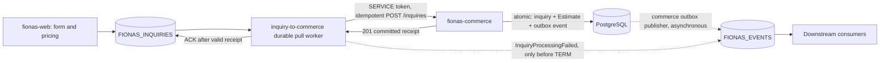

# Fiona's event workers

A small Node.js 26 / TypeScript npm monorepo for independently deployed NATS JetStream integration workers. The public web application owns form choices and pricing; commerce owns inquiry persistence and its canonical initial Estimate. Workers connect those boundaries through events and HTTP.



`InquirySubmitted v1` announces a priced request accepted by the web server. It does not assert commerce persistence.

### Who owns what

| Component | Responsibility |
|---|---|
| `fionas-web` | Produces `InquirySubmitted` after accepting and pricing a public inquiry. |
| `inquiry-to-commerce` (this repository) | Reliably transports that request to the commerce API and records, as `InquiryProcessingFailed`, the failures it owns. |
| `fionas-commerce` | Atomically commits the business facts (customer, inquiry, initial Estimate) **and** the success event in its transactional outbox, in one PostgreSQL transaction. Owns the success-event contract (a future commerce-owned `InquiryPersisted`). |
| Commerce outbox publisher | Asynchronously publishes committed business events from the outbox to `FIONAS_EVENTS`. |
| Downstream consumers | Independently process those events, each with its own durable idempotency. |

**The worker's input ACK no longer depends on any success-event PubAck, and the worker publishes no success event.** Once commerce returns a valid `201` receipt, the worker confirms the original JetStream ACK; it does not wait for, poll or verify the outbox publication. NATS remains part of the failure-disposition workflow: `InquiryProcessingFailed v1` is a minimal diagnostic for permanently unprocessable individual messages. A confirmed failure PubAck permits TERM; the original input remains retained. It describes a failure to process the incoming message, not a committed change to commerce state, and never asserts successful persistence or that commerce contains no inquiry. Systemic errors stop the worker for repair instead of rejecting every queued customer submission.

> **Cross-repository dependency.** This behavior relies on a strengthened commerce guarantee: *a valid HTTP 201 means the inquiry, initial Estimate and authoritative success outbox event committed atomically, and an idempotent replay returns the original receipt without appending another outbox event.* The worker cannot verify this. Do **not** deploy this version against a commerce whose `POST /inquiries` commits without that outbox write; the success event would be lost. See [Deployment cutover](#deployment-cutover).

## Structure and contracts

```text
workers/inquiry-to-commerce/  source, tests, independent build and Dockerfile
packages/events/             narrow incoming types and the owned InquiryProcessingFailed construction
scripts/                     explicit operator setup and isolated local initialization
infra/nats/                  local-only least-privilege NATS configuration
docs/                        contract audit, operations and coordinated full-system smoke test
asyncapi.yaml                owned InquiryProcessingFailed v1 contract
```

There is no inbound HTTP server, database, pricing logic or event framework. NATS uses `@nats-io/jetstream` and `@nats-io/transport-node` 3.4.0; HTTP uses native fetch. Dependencies are pinned in `package-lock.json`.

| Resource | Name / subject |
|---|---|
| Existing input stream | `FIONAS_INQUIRIES`, subjects `fionas.inquiries.>` |
| Input event | `fionas.inquiries.submitted.v1`, type `fionas.inquiry.submitted`, schemaVersion `1` |
| Worker durable | `inquiry-to-commerce`, exclusively filtered to the input subject |
| Shared event stream | `FIONAS_EVENTS`, subjects `fionas.events.>`. Holds this worker's failure diagnostics and the success events published by commerce's outbox publisher |
| Permanent processing failure (the only event this worker publishes) | `fionas.events.inquiry.processing-failed.v1`, type `fionas.inquiry.processing-failed`, schemaVersion `1` |

The [upstream AsyncAPI](https://github.com/castab/fionas-web/blob/main/asyncapi.yaml) remains authoritative for incoming data. The worker validates structural usability, not commerce's financial or business rules. It ignores unknown additive fields and forwards a fixed projection:

| Incoming property | HTTP / diagnostic mapping |
|---|---|
| `id` | HTTP `Idempotency-Key`, unchanged on every retry; failure-diagnostic `correlationId` |
| `data.name`, `email`, `zipCode`, `eventDate`, `eventType` | Same fields in HTTP body, unchanged |
| `data.message` | HTTP `message` only when present |
| `data.requestedService` | `guestCount`, optional `guestCountIsMinimum`, ordered `items` with label/group/key, optional `pricingReference` |
| `data.lines` | Complete ordered lines: description, optional subDescription/quantity, unitPrice, taxAmount, currency; exact strings unchanged |
| Envelope and `data.priceRevision` | Not included in HTTP body; no separate revision or totals invented |
| Commerce `201 {id, createdAt}` | Validated (UUID `id`, timestamp `createdAt`) and logged by identifier only; a successful status without a valid receipt is a systemic contract failure and is never ACKed |

The HTTP request projection is deterministic and fixed-order, so a repeat with the same input produces an identical body and key. The only event this worker publishes is `InquiryProcessingFailed`, whose identity and `Nats-Msg-Id` are `fionas.inquiry.processing-failed.v1:FIONAS_INQUIRIES:<stored-sequence>`. It contains no lines, ZIP, note, contact details, tokens or browser replay envelopes. See [asyncapi.yaml](asyncapi.yaml) and the [contract audit](docs/contract-audit.md).

## Local development

Install Node.js 26 and Docker, then from the repository root:

```sh
npm ci
npm run typecheck
npm test
npm run build --workspace @fionas/inquiry-to-commerce
npm run test:integration
```

Ordinary tests use pure fixtures and local HTTP stubs, including interactive prompt/password tests. Integration tests build the production worker image, automatically create a disposable real NATS 2.14.7 container/account on a random localhost port, check provisioning, least-privilege processing (including that the worker identity cannot publish a success event), lost HTTP-response and lost input-ACK recovery with idempotent replay, restart/redelivery, failure-diagnostic publication and targeted recovery, and exercise the packaged setup script and normal worker startup. Their HTTP backend is a synthetic stub that *models* the atomic commerce receipt contract (one simulated outbox append per idempotency key, none on replay); that is a test assumption, not proof of the real PostgreSQL outbox. Where a test needs a commerce-produced event on `FIONAS_EVENTS`, a separate operator identity publishes an opaque synthetic message; the worker never does. They then remove only their own containers and anonymous volume. No production secrets, backend or PostgreSQL are needed. Docker must be running; integration does not silently skip.

For an isolated development broker:

```sh
npm run nats:up
node scripts/nats-local-init.ts
```

The explicitly local initializer creates a missing development input stream and provisions outcomes/consumer. It uses public development credentials and hard-coded localhost. `npm run nats:down` stops it while preserving its named volume.

Copy `.env.example` to `.env`, provision a dedicated commerce SERVICE as below, and replace its ID/secret. Start from source or the compiled workspace:

```sh
npm run dev --workspace @fionas/inquiry-to-commerce
# Or build, export environment variables in your shell, then:
npm start --workspace @fionas/inquiry-to-commerce
```

To use the existing fionas-web broker instead, do not start a competing service on port 4222. Add the worker identity's permissions from [infra/nats/nats-server.conf](infra/nats/nats-server.conf) to that local account without changing the public publisher's permissions, restart the local broker and run the operator setup. Its existing `fionas-web` identity remains publish-only.

## Operator provisioning and SERVICE setup

Production setup expects `FIONAS_INQUIRIES` to exist already with file storage, limits retention and `fionas.inquiries.>`. It never creates or modifies that stream. Both streams use the worker's single NATS connection/account. Run the interactive setup with a separate operator NATS identity:

```sh
npm run nats:setup
# Optional settings; cluster deployments normally choose --replicas 3.
npm run nats:setup -- --retention-days 30 --replicas 1
```

The command builds the worker and launches `scripts/nats-setup.mjs`. It asks for a `nats://` or `tls://` address (default `NATS_URL` or localhost), then an operator `.creds` path, username/password, explicitly selected unauthenticated local development, or a preshared token (hidden). Environment values supply prompt defaults; password characters/defaults are never displayed. Ctrl+C cancels and restores the terminal. Credentials stay in memory and are not written to a file. No commerce credentials or additional confirmation prompt are required.

For automation, export `NATS_URL` and one of `NATS_CREDS_FILE`, both `NATS_USER`/`NATS_PASSWORD`, or `NATS_TOKEN`, then:

```sh
npm run nats:setup -- --non-interactive --retention-days 30 --replicas 1
```

Without a terminal, `--non-interactive` is required. Supply exactly one authentication method. Direct `.mjs` execution requires an existing worker build (already included in the Docker image).

Setup displays every explicitly managed stream/consumer property before provisioning, with NATS duration values in nanoseconds, then reports each resource as created or verified. It checks existing resources before creating missing ones and reports mismatched properties with existing/desired values, with no update operation. Operators must deliberately reconcile differences. If a creation fails after another resource was created, that new resource is retained; rerunning safely verifies it. Outcomes use file storage, limits retention, 30-day default finite retention, a 24-hour duplicate window and disabled message deletion/purge/rollup. Retention days must be finite, positive integers. Review customer-data retention before increasing them.

To automate the commerce steps below, run `npm run commerce:setup`. It prompts for the `fionas-commerce` base URL, a trusted browser Origin (it must be listed in commerce's `FIONAS_TRUSTED_ORIGINS`) and an administrator username/password (hidden), logs in, shows what it will do and asks for confirmation (`--yes` skips it). It verifies or creates the `inquiry-to-commerce` SERVICE and the `fionas.inquiry-worker` role, refuses to touch a role whose permissions are not exactly `fionas.inquiries.create`, assigns the role and issues a **new** credential on every run. The secret is written once to a private file (default `commerce-service.secret`, gitignored, never overwritten; choose another with `--secret-out`) or printed with `--print-secret`; the administrator password is never stored, and the administrator session is logged out afterwards. The administrator needs `commerce.principal.manage`, `commerce.role.manage`, `commerce.role.assign` and `commerce.service-credential.manage`, which the bootstrap Administrator role holds. Login is limited to five attempts per IP burst. The manual steps it performs are:

In commerce, log in as an authorized administrator, with its existing trusted Origin requirements. Use the existing administration endpoints to:

1. Create a new SERVICE via `POST /admin/access/services`, named `inquiry-to-commerce`.
2. Create a dedicated role, e.g. `fionas.inquiry-worker`, granting exactly `fionas.inquiries.create`.
3. Assign it with `PUT /admin/access/services/{serviceId}/roles/fionas.inquiry-worker`.
4. Issue a credential via `POST /admin/access/services/{serviceId}/credentials` with a label; capture the returned secret once in private configuration.

Do not reuse fionas-web or staff credentials. The worker exchanges `{serviceId,secret}` at `/auth/service/token`, caches the short-lived Bearer token in memory and refreshes shortly before `expiresAt`. Inquiry `401` invalidates the token and retries the identical request once with a replacement; `403` does not refresh. No token-signing key is needed by the worker. Rotate credentials by issuing a replacement, deploying it, verifying it and revoking the old credential. [Upstream SERVICE documentation](https://github.com/castab/fionas-commerce/blob/main/README.md) describes the administrative request contracts.

The runtime NATS user needs only these publish permissions and `_INBOX.>` subscriptions:

```text
$JS.API.CONSUMER.INFO.FIONAS_INQUIRIES.inquiry-to-commerce
$JS.API.CONSUMER.MSG.NEXT.FIONAS_INQUIRIES.inquiry-to-commerce
$JS.ACK.FIONAS_INQUIRIES.inquiry-to-commerce.>
$JS.ACK.*.*.FIONAS_INQUIRIES.inquiry-to-commerce.>
fionas.events.inquiry.processing-failed.v1
```

Publication is limited to the failure-diagnostic subject. The runtime identity must **not** be granted `fionas.events.inquiry.persisted.v1` or any other success subject: success events are published by commerce's outbox publisher under its own identity. When upgrading from the previous release, remove the former `fionas.events.inquiry.persisted.v1` publish permission as part of the cutover below. The second ACK pattern supports domain/account-hash ACK subjects while staying scoped to this stream/consumer. This configuration assumes the default `$JS.API` prefix, no JetStream domain prefix, and both streams in the same account. INFO is read-only and needed for binding/reconnect; runtime has no stream INFO, CREATE, UPDATE, DELETE, general consumer access or general JetStream administration. JWT credentials and TLS are recommended in production. Provision NATS identities through your existing operator/account tooling; this repository does not generate production credentials.

## Environment and Docker

| Variable | Purpose |
|---|---|
| `NATS_URL` | Required single `nats://` or `tls://` server URL without embedded credentials |
| `NATS_CREDS_FILE` | Optional mounted JWT credentials path; exclusive with user/password |
| `NATS_USER`, `NATS_PASSWORD` | Supported pair, development or operator-approved alternative |
| `NATS_TOKEN` | Preshared server token; exclusive with the other methods. A token server has no per-client permissions, so the worker then holds full access rather than the scoped runtime permissions below. Prefer per-identity credentials when the server supports them |
| `COMMERCE_BASE_URL` | Required HTTP(S) origin; no credentials, path, query or fragment |
| `COMMERCE_SERVICE_ID` | Required dedicated SERVICE UUID |
| `COMMERCE_SERVICE_SECRET` | SERVICE credential; exclusive with secret file |
| `COMMERCE_SERVICE_SECRET_FILE` | Mounted UTF-8 credential alternative; surrounding file whitespace trimmed |

Startup validates configuration and verifies the existing durable configuration. Secrets never enter logs. Interactive setup prompts for its NATS configuration; automated setup requires only NATS variables. No tunable HTTP/concurrency framework is exposed; the initial defaults are explicit in source.

```sh
docker build -f workers/inquiry-to-commerce/Dockerfile -t fionas-inquiry-to-commerce:local .
docker run --rm --name inquiry-to-commerce --stop-timeout 60 \
  --env-file .env fionas-inquiry-to-commerce:local
```

The image compiles in a build stage, installs production dependencies only in the runtime stage, runs as `node`, and exposes no port. If NATS/commerce run on the Docker host, use `host.docker.internal` on Docker Desktop in the environment supplied to the container. On Linux use the appropriate Docker network or add `--add-host=host.docker.internal:host-gateway`. Mount secret files read-only at their configured paths; do not bake them into the image.

The same image packages the interactive setup script. Run it as a separate operator command; normal worker startup does not provision resources:

```sh
docker run --rm -it --entrypoint node fionas-inquiry-to-commerce:local scripts/nats-setup.mjs
# With a read-only operator credentials mount (readable by the image's node user):
docker run --rm -it --entrypoint node \
  --mount type=bind,src=/absolute/path/operator.creds,dst=/run/secrets/operator.creds,readonly \
  -e NATS_CREDS_FILE=/run/secrets/operator.creds \
  fionas-inquiry-to-commerce:local scripts/nats-setup.mjs
```

Enter a server reachable from the container, e.g. `nats://host.docker.internal:4222` on Docker Desktop, and accept the mounted credentials-path default. Use your platform's absolute source path for the bind mount. For automation omit `-it`, supply the NATS environment variables/mount, and append `--non-interactive`; the image needs no build step at execution time.

## Watch stream messages

```sh
npm run nats:tail:events
npm run nats:tail:inquiries
```

Both commands prompt for the NATS address and operator credentials, with the same environment defaults and hidden password entry as setup. They follow newly arriving messages in the entire selected stream. Add `-- --all` to replay retained messages first and continue watching, or `-- --limit 10` to exit after ten messages. Ctrl+C stops the viewer.

Each viewer owns a temporary, no-ACK ordered consumer; it never binds to or acknowledges the worker's durable. It deletes its consumer on exit; after an abrupt termination or failed cleanup, the consumer expires after 60 seconds of inactivity. Stream configuration and stored messages remain unchanged. Use separate operator credentials with stream inspection and ephemeral-consumer create/read/pull/delete permissions; the runtime worker and public publisher identities intentionally lack these permissions. Locally use `fionas-admin` / `fionas-admin-dev` against the development broker.

Output is newline-delimited JSON, one record per message: `stream`, `sequence`, `subject`, `timestamp`, `headers` (arrays of values), and `payload`. JSON payloads are parsed, other UTF-8 payloads appear as strings, and binary payloads are represented with base64 encoding. Status/error output goes to stderr. These operator views include the stored customer data.

To hook another script into the output, set the operator NATS environment and use non-interactive mode; silence npm's own command banners:

```sh
npm --silent run nats:tail:events -- --non-interactive | node your-reader.mjs
npm --silent run nats:tail:inquiries -- --non-interactive --all --limit 10
# After a worker build, direct execution needs no npm wrapper:
node scripts/nats-tail.mjs events --non-interactive
```

The Docker image also includes the viewer:

```sh
docker run --rm -it --entrypoint node fionas-inquiry-to-commerce:local scripts/nats-tail.mjs events
```

Use the same read-only operator credentials mounts and container-reachable address as setup. For piped Docker output, omit `-it`, supply the NATS environment/mount and append `--non-interactive`. Viewers reconnect through transient NATS disconnects; if a prolonged interruption expires their temporary consumer, restart the command (`--all` replays what is still retained). These viewers are inspection tools, not durable event processors.

## Delivery and operations

The worker pulls one message at a time; consumer `max_ack_pending=1`, `max_batch=1`. The 90-second ACK deadline exceeds bounded HTTP/token calls (10 seconds each), failure-diagnostic publish (5 seconds) and confirmed input ACK (5 seconds). No business success is inferred from a network write. Only a valid `201` receipt permits the input ACK, and the ACK must itself be confirmed; there is no success-event publication or PubAck in this path. A successful ACK confirms that commerce acknowledged the original operation, not that commerce's outbox publisher has already delivered its event to NATS.

| Failure class | Policy |
|---|---|
| Permanent per-message: malformed/unsupported input, inquiry `400`/`422`, `409 IDEMPOTENCY_KEY_REUSED` | Publish deterministic InquiryProcessingFailed to FIONAS_EVENTS; require expected-stream PubAck (duplicates accepted), then TERM. No success ACK. |
| Transient: `408`, `429`, `5xx`, timeout/connection failure (including a response lost after commerce committed: the outcome is unknown, so the identical request and key are repeated), `409 conflict`, unconfirmed failure publication/input ACK | Delayed NAK: 10s, 30s, 2m, 5m, then 15m, at most ten deliveries. |
| Systemic: failed SERVICE exchange, inquiry `401` after its single refresh, `403`, redirects/unexpected statuses, malformed token/receipt or unknown `409` | Log operator attention and exit nonzero before pulling another inquiry. No failure event, TERM, or success ACK for the affected customer. |

If transient retries or failure-record publication exhaust ten attempts, the worker logs `exhausted:true` and halts with `retry_exhausted`. It does not mark the submission permanently invalid. The retained original, identifiers in logs, and maximum-delivery advisories support targeted operator recovery. A final crash can exhaust attempts without the worker observing the last failure, so monitor server advisories as well. Until exhaustion, a transient outage can block later work through the one pending slot; this is deliberate fail-closed behavior during unavailable infrastructure. Crashes/unconfirmed TERM use the ACK deadline; replay republishes the same deterministic failure ID. If failure publication is unavailable, no TERM is sent.

Failure identity / Nats-Msg-Id is `fionas.inquiry.processing-failed.v1:FIONAS_INQUIRIES:<stored-sequence>`. Its envelope carries optional original UUID correlation, original NATS stored timestamp, and only input stream, sequence and stable error code. No customer or financial data is copied. The stored timestamp makes retries byte-stable; it is not when the worker detected the failure. Failure records share the outcome stream's 30-day retention and 24-hour publication deduplication. See [operations](docs/operations.md) for observed starvation, targeted recovery and retention limits.

SIGTERM/SIGINT stop new pulls and give current work up to 55 seconds. The deadline aborts HTTP and closes NATS; unfinished inputs stay unacknowledged. Set supervisor termination timeout to at least 60 seconds. The client reconnects after established-connection failures; transient pull errors wait two seconds before retry. NATS permission errors halt for repair. Configure supervisor restart backoff/limits and alert on `worker_halted`; repair systemic configuration or investigate exhausted attempts before restarting rather than blindly cycling queued inquiries.

This is **at-least-once delivery**. The input ACK and the commerce HTTP commit are not a distributed atomic transaction: a lost HTTP response or input ACK, or a crash between them, recovers by repeating the identical database-idempotent request (same event UUID as `Idempotency-Key`, same body), which must return the original receipt and must not append another outbox event. The HTTP/NATS atomicity gap that previously sat between commit and success-event publication has moved into commerce, where the inquiry and its outbox event commit in one database transaction and the outbox publisher delivers at least once. Failure-diagnostic publication still has the NATS-side limitation that deduplication lasts only 24 hours: a later replay can store another diagnostic with the same ID. Downstream consumers, especially before sending email, must persist their own operation deduplication on the event id. Never claim exactly-once end-to-end delivery.

## Deployment cutover

This worker change was developed ahead of its commerce counterpart. **Do not deploy it, or merge it into an automatically deployed branch, until commerce's outbox integration is live.** Required order:

1. Release the shared transactional outbox infrastructure (`commerce-runtime`).
2. Integrate it into `fionas-commerce`.
3. Add commerce-owned `InquiryPersisted` outbox writes in the same transaction as the inquiry and initial Estimate.
4. Configure the commerce NATS outbox publisher (its own identity, publishing to `FIONAS_EVENTS`).
5. Verify successful outbox-to-NATS publication.
6. Deploy this revised worker as a coordinated cutover and remove the worker identity's `fionas.events.inquiry.persisted.v1` publish permission.
7. Confirm that only commerce publishes the authoritative success event.

Until then the previously deployed worker keeps its behavior; there is no permanent legacy mode or implicit fallback. If an interim dual-version deployment becomes necessary, document it explicitly instead of adding a fallback. `FIONAS_INQUIRIES`, `FIONAS_EVENTS` and the `inquiry-to-commerce` durable are unchanged; do not delete, recreate, rewind or reset them.

Retained inputs created before cutover are replayed safely: an idempotent replay of an already-committed inquiry returns its existing receipt and must not manufacture a new business event. If older records need a success-event backfill, that is a separate, deliberate recovery procedure owned by commerce, not something this worker or its retry tool does.

To add another worker, create a separate workspace with its own single responsibility, durable, credentials, tests and Dockerfile. Subscribe independently to the appropriate retained stream and document supported versions/idempotency. Share concrete event contracts; extract infrastructure only after real repetition. No process-level dependency on this worker is needed.

CI runs typecheck, tests, the independent workspace build, real-NATS integration and a Docker build on pull requests and main pushes. It does not publish images. [Optional backend smoke test](docs/manual-smoke.md) covers a privately provisioned local commerce instance.
